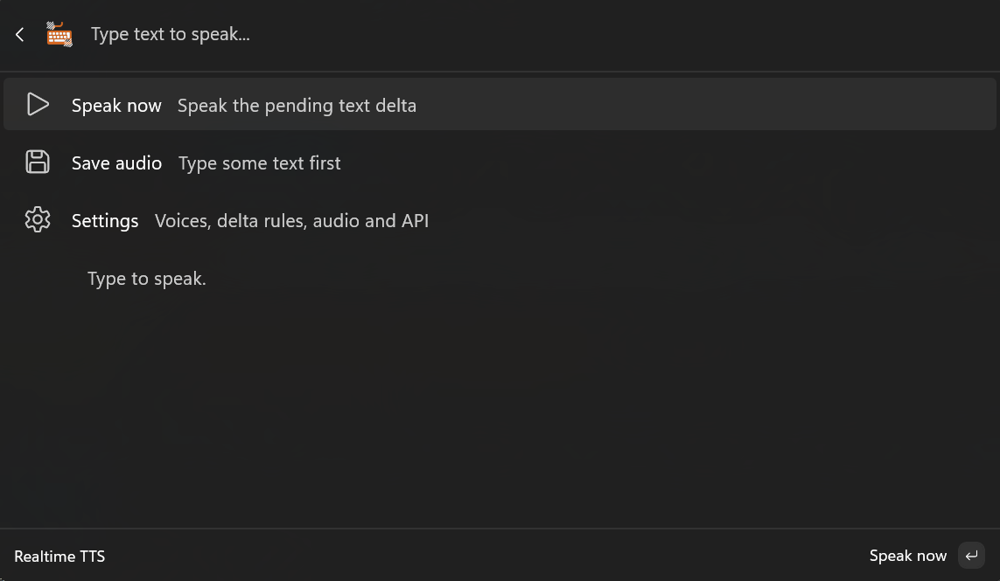
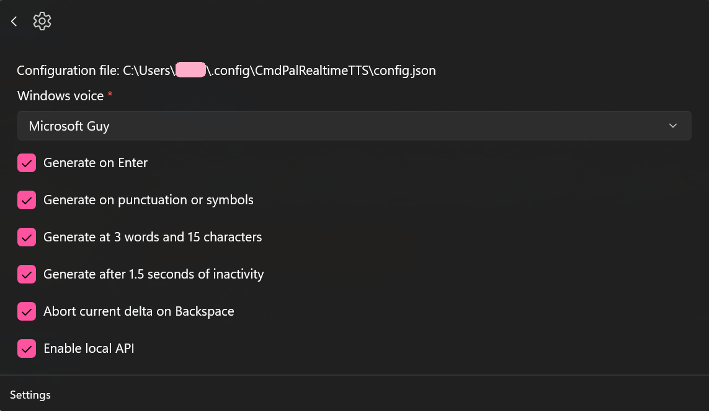
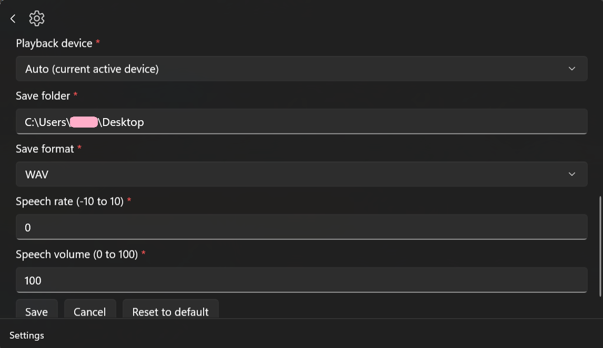

<p align="center"></p>

##  Realtime TTS | A simple extension for [Command Palette](https://learn.microsoft.com/en-us/windows/powertoys/command-palette/overview) (from [Power Toys](https://github.com/microsoft/PowerToys))

This extension allows the user to generate speech directly by just typing. The way it works is delta based, that means the text you type gets chunked based on [Delta Generator Options](#delta-generator-options) and gets played in a queue.

The speech engine is based on Windows's own narrator voice.

It also supports a basic API route, configurable in settings.

## Installation

> [!IMPORTANT]
> 
> Current debug release is **NOT SIGNED** and it needs administrator privileges for installation.
> 
> The extension is not yet published to MS Store or Winget. It needs manual file download & installation.

1. Go to The [v0.5.0 Debug Release](https://github.com/amirgame197/CmdPal-Realtime-TTS/releases/tag/v0.5.0) page and download the `.msix` file.
2. Once downloaded, open a Powershell Terminal with <u>Administrator privileges</u> in the same directory as the downloaded file.
3. Run the command below:
   ```powershell
   Add-AppxPackage -Path "CmdPalRealtimeTTS_0.5.0_x64_Debug.msix" -AllowUnsigned
   ```
   This should start installing the extension.

4. After installing, open the Command Palette. The extension should be discovered and accessible by searching `Realtime TTS`.


## Building From Source

```powershell
# Clone the repo if not done yet
git clone https://github.com/amirgame197/CmdPal-Realtime-TTS
cd CmdPal-Realtime-TTS

# Remove any existing build artifacts
Remove-Item .\src\bin, .\src\obj, .\src\AppxPackages -Recurse -Force -ErrorAction SilentlyContinue 
dotnet restore

# Run the core tests to verify any potential runtime errors
dotnet run --project .\tests\CoreChecks\CoreChecks.csproj --configuration Debug -p:Platform=x64

# Build the debug version's .msix file (appx package)
dotnet build .\CmdPalRealtimeTTS.sln --configuration Debug -p:Platform=x64 -p:GenerateAppxPackageOnBuild=true -p:AppxPackageDir="AppxPackages\"

# Or if you just want to build the .exe file, dont add the last two args
dotnet build .\CmdPalRealtimeTTS.sln --configuration Debug -p:Platform=x64
```

## Delta Generator Options

| Option | Description |
| --- | --- |
| Generate on Enter | This option lets the speech to start generating directly when you press the Enter key. |
| Generate on punctuation or symbols | Generate the pending delta when any symbols (`? ! @ # . , $`) are typed. |
| Generate at 3 words and 15 characters | Start generating the delta when you type 3 words with at least 15 characters. This might not work very well in some cases, especially when the typing speed is slower than the speech rate. |
| Generate after 1.5 seconds of inactivity | Should the pending delta automatically gets played when you stop typing for 1.5 seconds? |
| Abort current delta on Backspace | If you press Backspace, this sends a stop signal for current playing delta. |

## TTS Settings

<p align="center"></p>

| Feature | Default value | Description |
| --- | --- | --- |
| Windows voice | `Auto (Windows default)` | The voice model to use when generating speech **`*`**. |
| Playback device | `Auto (current active device)` | Where should the generated speech be played? **`**`** |
| Save folder | `%USERPROFILE%/Desktop` | When saving the generated audio, where should the audio file be saved? |
| Save format | `WAV` | The format of the audio to save. WAV is raw and heavy, MP3 is compressed and light |
| Speech rate | `0` | The speed of generated speech. Higher is faster and thinner. |
| Speech volume | `100` | How loud should the generated speech be. This does not add to the audio gain, so the value is capped at `100`. |

> **`*`**. The system uses Windows native voice models, but you can install the new natural voices using [Natural Voice SAPI Adapter](https://github.com/gexgd0419/NaturalVoiceSAPIAdapter) which is compatible with this extension.<br>
> **`**`**. If you want your microphone to play the generated speech as if you are talking, you can install [VB-Audio Virtual Cable](https://vb-audio.com/Cable/) and choose the newly added `CABLE Input (VB-Audio Virtual Cable)` as your playback device. With that, a virtual microphone called `CABLE Output` will play the speech back.

## API Capabilities

| Route | Methods | Description |
| --- | --- | --- |
| `/generate` | `GET` / `POST` | This route simply adds the input `text` to the speech delta queue. |
| `/abort` | `GET` | This forcefully aborts the current playing delta. |

<br><br>
<p align="center"></p>
